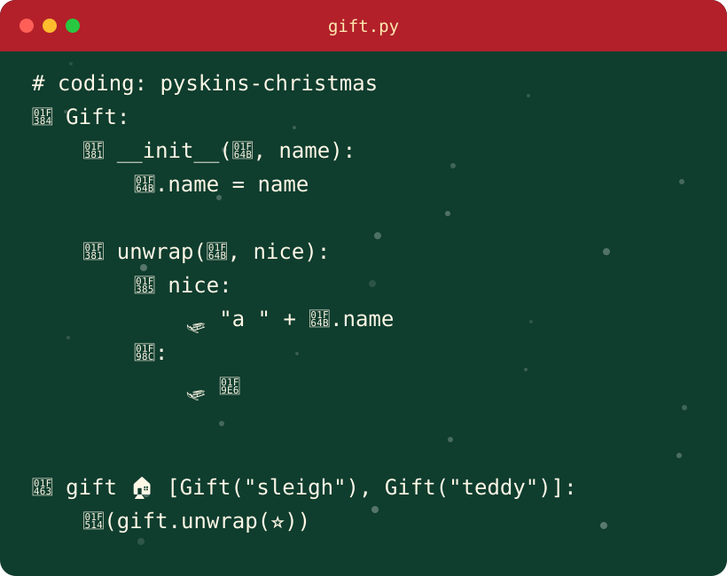
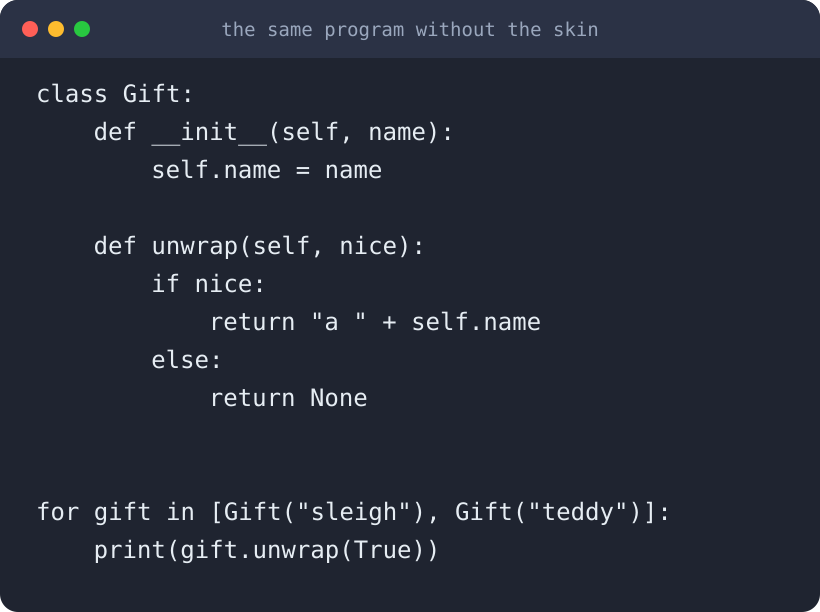
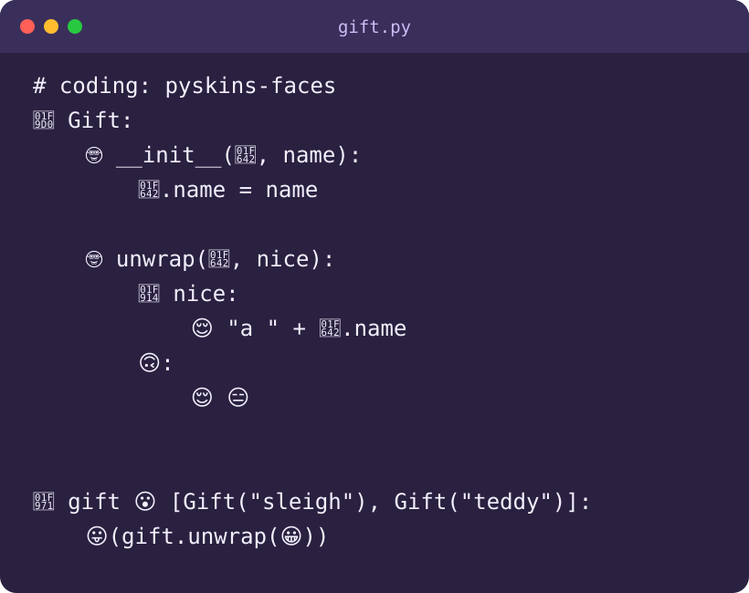

<h1 align="center">🎄 pyskins 🎁</h1>

<p align="center"><b>Python files written in emoji. And yes, they run.</b></p>

<p align="center">
  <a href="https://pypi.org/project/pyskins/"></a>
  <a href="https://github.com/AlexandruGirlea/pyskins/actions/workflows/tests.yml"></a>
  <a href="https://pypi.org/project/pyskins/"></a>
  <a href="https://github.com/AlexandruGirlea/pyskins/blob/main/LICENSE"></a>
</p>

<p align="center">
  <a href="https://transylvaniabytes.com/pyskins/"></a>
  &nbsp;
  <a href="#-install"></a>
  &nbsp;
  <a href="#-fun-programs-to-open"></a>
  &nbsp;
  <a href="#-let-your-ai-assistant-do-it"></a>
  &nbsp;
  <a href="#-hide-what-it-does-obfuscation"></a>
</p>

<p align="center"><b><a href="https://transylvaniabytes.com/pyskins/">▶ Try pyskins in your browser</a></b> — no install, pick a skin and watch your code change.</p>

<p align="center">
  
</p>

```sh
python gift.py
```

That works. 🎅 The file is wearing a skin, and the first line tells Python which one. Under the hood it is the same Python as always:

<p align="center">
  
</p>

Nobody has an emoji keyboard for this, and nobody needs one. You code with your AI assistant as always. It writes normal Python, and `pyskins` puts the skin on.

<a name="install"></a>

## 🚀 Install

```sh
pip install pyskins
```

That is all. From now on, your Python can run skinned files.

```sh
pyskins apply christmas app.py    # put the skin on, in place
python app.py                     # run it. Yes, really.
pyskins undo app.py               # normal Python back, in place
```

Not a single character of your code gets lost on the way. `apply`, `undo` and `obfuscate` change the file in place by default; add `-o copy.py` to keep the original. For `apply` and `undo`, `-o -` prints to the screen instead.

<details>
<summary>All commands</summary>

```sh
pyskins list                      # which skins do I have?
pyskins show faces                # what stands for what, and why?
pyskins apply SKIN app.py         # skin on, in place (SKIN is a name or a .json path)
pyskins apply -s ./my.json app.py # the skin can be your own file, by path
pyskins undo app.py               # skin off, in place
pyskins run app.py                # run it, also where pyskins is not installed into Python
pyskins new NAME                  # start your own skin
pyskins check NAME.json           # test your skin
pyskins add NAME.json             # keep your skin, to use it by name
pyskins obfuscate app.py          # hide everything in emoji, in place, and write a key
```

Use `-` as the file name to read from a pipe: `cat app.py | pyskins apply christmas -` prints to the screen.

</details>

<a name="ai"></a>

## 🤖 Let your AI assistant do it

This repository comes with a skill for coding agents. It teaches them how to work with skins: write normal Python, test it, put the skin on with `pyskins`, and run the emoji file. No emoji typed by hand, by you or by the agent.

Install the skill into a project with [APM](https://github.com/microsoft/apm):

```sh
apm install AlexandruGirlea/pyskins
```

If APM cannot tell which tool you use, name it: `apm install AlexandruGirlea/pyskins --target claude` (or `codex`, `cursor`, `copilot`).

| Tool | What it gets |
|---|---|
| Claude Code | `.claude/skills/pyskins/` and `.claude/rules/pyskins.md` |
| Codex, OpenCode and others that read `.agents/` | `.agents/skills/pyskins/`, and the rules in `AGENTS.md` after `apm compile` |
| Cursor | `.cursor/rules/pyskins.mdc` |
| GitHub Copilot | `.github/instructions/pyskins.instructions.md` |

No APM? Copy the folder `.apm/skills/pyskins/` into `.claude/skills/` or `.agents/skills/`, or paste the text of `.apm/instructions/pyskins.instructions.md` into your `CLAUDE.md` or `AGENTS.md`.

Then just ask:

> Write a small guessing game in Python, in the Christmas skin, and run it.

## 🧥 Pick a skin

Two skins come in the box. Each one covers all 35 Python keywords and 26 everyday helpers such as `print`, `len`, `range` and `list`.

### 🎄 christmas

Gifts, bells, snow and candlelight. Ho ho ho!

🎄 `class` &nbsp; 🎁 `def` &nbsp; 🎅 `if` &nbsp; 🤶 `elif` &nbsp; 🦌 `else` &nbsp; 🛷 `return` &nbsp; 👣 `for` &nbsp; 🔔 `print` &nbsp; ⭐ `True` &nbsp; ❌ `False` &nbsp; 🧦 `None` &nbsp; 📜 `list`

Take one step 👣 `for` each item. Keep going 🕯️ `while` the candle burns. A scarf 🧣 wraps a `with` block, a snowflake ❄️ stands for the distinct elements of a `set`, and ice 🧊 holds a `tuple` in fixed positions.

`try` a cookie 🍪. If it burns, that is an `except` 🔥. `finally`, a glass of milk 🥛.

### 🧐 faces

Every word gets a face that fits its mood.

<p align="center">
  
</p>

🧐 `class` &nbsp; 🤓 `def` &nbsp; 🤔 `if` &nbsp; 🤨 `elif` &nbsp; 🙃 `else` &nbsp; 😌 `return` &nbsp; 🥱 `for` &nbsp; 😛 `print` &nbsp; 😀 `True` &nbsp; 🙁 `False` &nbsp; 😑 `None` &nbsp; 👥 `list`

Want the whole list, with the reason for every emoji? Ask the tool:

```sh
pyskins show christmas
```

```text
Christmas: Python wrapped for the holidays: gifts, bells, snow and candlelight. Ho ho ho!

🧺  all       every item in the basket
🍬  and       candy and more candy
🍫  any       any chocolate from the box
🎀  as        with a name tag on it
✅  assert    checked twice: it must be true
🌨️  async     many snowflakes in flight
⏰  await     wait for midnight
💡  bool      the lights are on or off
```

<a name="examples"></a>

## 🎮 Fun programs to open

Seven small programs, each one a `.py` file in emoji. Click one, try to read it, then run it.

| What it does | The file | Skin | Run it |
|---|---|---|---|
| 🎄 How many sleeps until Christmas? | [christmas_countdown.py](https://github.com/AlexandruGirlea/pyskins/blob/main/examples/christmas_countdown.py) | christmas | `python examples/christmas_countdown.py` |
| 🎁 Secret Santa: who gives a gift to whom | [secret_santa.py](https://github.com/AlexandruGirlea/pyskins/blob/main/examples/secret_santa.py) | christmas | `python examples/secret_santa.py` |
| 🔢 FizzBuzz, the classic | [fizzbuzz.py](https://github.com/AlexandruGirlea/pyskins/blob/main/examples/fizzbuzz.py) | christmas | `python examples/fizzbuzz.py` |
| 🚀 Check, count down, lift off | [rocket_launch.py](https://github.com/AlexandruGirlea/pyskins/blob/main/examples/rocket_launch.py) | faces | `python examples/rocket_launch.py` |
| 🎲 One robot picks a number, another finds it | [guess_the_number.py](https://github.com/AlexandruGirlea/pyskins/blob/main/examples/guess_the_number.py) | faces | `python examples/guess_the_number.py` |
| 🐱 Every pet gets a grand new name | [pet_names.py](https://github.com/AlexandruGirlea/pyskins/blob/main/examples/pet_names.py) | faces | `python examples/pet_names.py` |
| 🤖 A robot that says hello, unless it is tired | [robot.py](https://github.com/AlexandruGirlea/pyskins/blob/main/examples/robot.py) | faces | `python examples/robot.py` |

This is [secret_santa.py](https://github.com/AlexandruGirlea/pyskins/blob/main/examples/secret_santa.py), all of it:

```text
# coding: pyskins-christmas
"""Secret Santa: everyone gives one gift, and nobody gives a gift to themselves."""

📦 random
💌 collections 📦 deque

friends = ["Ana", "Bogdan", "Carmen", "Dan", "Elena"]


🎁 draw(names, seed=🧦):
    names = 📜(names)
    random.Random(seed).shuffle(names)
    receivers = deque(names)
    receivers.rotate(1)
    👣 giver, receiver 🏠 🧤(names, receivers):
        🧁 giver, receiver


pairs = 📖(draw(friends, seed=2026))
👣 giver 🏠 friends:
    receiver = pairs[giver]
    ✅ giver != receiver
    🔔(giver, "gives a gift to", receiver)
```

Curious what it says in normal Python? `pyskins undo examples/secret_santa.py -o -`

## 🎨 Make your own skin

Pizza? Halloween? Pirates? Your cat? Three commands and about ten minutes. Or ask your AI assistant: the skill knows how.

```sh
pyskins new pizza          # makes pizza.json with every word listed, empty
pyskins check pizza.json   # tells you what is missing or wrong, and tests the skin
pyskins add pizza.json     # saves it to your own skins: now "pizza" works by name
```

Between the first and the second command, fill in `pizza.json`. Each word gets an emoji and a few words that say why:

```json
{
  "name": "pizza",
  "title": "Pizza",
  "description": "Python with extra cheese.",
  "words": {
    "class": ["🍕", "the whole pizza"],
    "def": ["🔪", "slice and prepare"],
    "return": ["🛵", "the delivery scooter"],
    "print": ["🔔", "order up!"]
  }
}
```

No need to finish in one go. A word you leave empty keeps its normal look, and `pyskins check` shows what is still open.

A skin can do more than emoji:

- **Use words.** [php.json](https://github.com/AlexandruGirlea/pyskins/blob/main/examples/skins/php.json) makes Python look a little like PHP:

  ```text
  function greet(this, name):
      if name is null:
          return false
      echo("hello", name)
  ```

- **Build on another skin.** [easter.json](https://github.com/AlexandruGirlea/pyskins/blob/main/examples/skins/easter.json) says `"extends": "faces"` and changes only six words.
- **Rename any name,** not only the built-in ones.

If a skin could not be taken off again, the tool refuses it and tells you which word is the problem. So you cannot break anything by trying.

<details>
<summary>Where skins live</summary>

| Place | For |
|---|---|
| `pyskins/skins/` in this project | The skins that come in the box |
| `~/.pyskins/` | Your own skins. `pyskins add` puts them there |
| Folders named in `PYSKINS_PATH` | Skins shared by a team or kept in a project |

</details>

<a name="hide"></a>

## 🕵 Hide what it does (obfuscation)

A theme skin keeps your code readable. Obfuscation hides *everything* — every name you chose, every keyword, every string — but keeps the **Python shape**: the same indentation, the same punctuation, the same line breaks between statements. The file still looks like Python; it just says nothing to a reader. (One exception: a string that spans several lines becomes a single emoji on one line — `undo` puts it back exactly.)

```sh
pyskins obfuscate app.py --skin christmas
```

Your code:

```text
class Robot:
    def greet(self, tired):
        if tired:
            return 'zzz...'
        return 'hi'
```

becomes (shape kept, nothing readable):

```text
🎄 🟥:
    🎁 🟧(🙋, 🟨):
        🎅 🟨:
            🛷 🟩
        🛷 🟦
```

Your names (`Robot`, `greet`, `self`, `tired`), the keywords, and the strings are all gone — `greet` too, even where it is called as `robot.greet()`. The `--skin` flavours the keywords with a theme; leave it off and they take plain emoji.

It still runs, because — like any skin — the file carries a first line that names its key, and pyskins turns it back into your exact code before Python runs it:

```sh
python app.py                             # runs, once the key is installed (pyskins add app.json)
pyskins run --skin app.json app.py        # or run it without installing
pyskins undo app.py --skin app.json       # your code back, exactly
```

`obfuscate` changes the file in place by default and writes a **key** next to it; add `-o secret.py` to keep the original. Keep the key: it is the only way back, and the only way to run the file.

### A whole project at once

Point `obfuscate` at a folder and it hides every `.py` file under it, through the subfolders, with **one key** for the lot. Your originals are not touched:

```sh
pyskins obfuscate myapp/ -o myapp_secret/   # the whole tree, one key
pyskins add myapp_secret.json               # install the key once
python myapp_secret/app.py                   # runs just like the original
pyskins undo myapp_secret/ -o myapp_back/ --skin myapp_secret.json   # get it all back
```

**Honest about what it is — not a secret keeper.** Obfuscation is reversible by design, so it hides your code from a reader, not from anyone who has the key. A few things to know:

- The **key is plaintext**: the `.json` lists your original names and strings next to their emoji. Anyone with the key reads everything. Keep keys out of version control (add them to your `.gitignore`), and treat a key as being as sensitive as the source.
- **Everything in a `.py` is hidden** — names, keywords, strings, f-strings and comments all become emoji (the shape stays). A `#!` shebang on the first line is kept readable, because the OS reads it before Python does.
- Obfuscating a **folder copies non-`.py` files unchanged** — a `.env`, a config, a data file goes across as-is. It does not hide those.
- Obfuscating a **folder skips some subfolders**: those whose name starts with a dot, and `__pycache__`, `node_modules`, `venv`, `env` and `site-packages`. Nothing in them is obfuscated or copied.

Use it to make code fun and unreadable at a glance, not to protect secrets.

## 🤝 Contribute, expand it, star it

pyskins is young, and there is plenty of room to grow. New skins, fun example programs, bug fixes and bigger ideas are all welcome: fork it, expand it, and open a pull request. Not sure where to start? [Open an issue](https://github.com/AlexandruGirlea/pyskins/issues) and say hello.

**Send us your skin.** We would love to add it. 🍕 Pizza, 🎃 Halloween, 🚀 space, 🏴 pirates, 🐱 cats, ⚽ football, Python in your own language: all welcome.

1. Make the skin with the three commands above.
2. Put the file in `pyskins/skins/`.
3. Open a pull request.

The tests find new skin files by themselves, so there is nothing else to write. [CONTRIBUTING.md](https://github.com/AlexandruGirlea/pyskins/blob/main/CONTRIBUTING.md) has the few rules and some tips for a skin that makes people smile.

**⭐ Star the repo** on [GitHub](https://github.com/AlexandruGirlea/pyskins) if pyskins made you smile. It helps other people find it.

## 🔍 Good to know

- **Your editor will complain.** It does not know about skins, so it underlines the emoji. Python runs the file anyway.
- **The first line matters.** `# coding: pyskins-christmas` tells Python which skin the file wears. Keep it as the first line.
- **Python needs pyskins installed** to run a skinned file. Without it, Python stops with a `SyntaxError` that names `pyskins-christmas`. Skinned files can import each other.
- **Nothing in your code changes** except the words of the skin. Strings, comments, f-strings, spacing and line endings stay exactly as they were.
- **The skin always comes off.** Before you get a skinned file, the tool takes the skin off again and compares with your original. If anything differs, it stops.
- **Linters, formatters and type checkers** want normal Python. Take the skin off for those: `pyskins undo`.
- **"pip install" works for the Python you installed it into** — that interpreter or virtual environment. A `pip install --target`, `python -S`, or some `pipx`/`uv tool` installs do not hook the start-up file; there, use `pyskins run`.
- **What install actually does.** Installing drops a small `.pth` file next to the package, so that Python registers a source codec at **every start-up** of that interpreter. It is lazy and only ever handles `pyskins-*` coding lines — every other file reads exactly as before — but it is a change to that interpreter, and it stays on for as long as pyskins is installed (`pyskins run` does **not** turn it off; `run` is for interpreters where pyskins is *not* installed, where it registers the codec just for that one run). To avoid the start-up hook, don't `pip install` pyskins into that interpreter — keep it in its own virtual environment, or use `pyskins run` from an interpreter that does not have it installed.
- **A file that already has its own `# coding:` line** (such as `# -*- coding: utf-8 -*-`) is refused by `apply`. Remove that line first.
- **On Windows, use `-o`** rather than `>` or a pipe: PowerShell re-encodes the output and would corrupt the emoji.

## 🐍 Python versions

Plain Python, no dependencies, no newer language features. Every push runs the tests on Python 3.8 through 3.15, on Linux and macOS. A file skinned on one version runs and comes back exactly on another.

pyskins needs Python 3.8 or newer.

<details>
<summary>Use it from your own Python code</summary>

```python
import pyskins

skin = pyskins.load_skin("christmas")
dressed = pyskins.apply("if True: pass\n", skin)
plain = pyskins.undo(dressed, skin)
```

| Name | What it does |
|---|---|
| `load_skin(name_or_path)` | Loads a skin by name, or from your own `.json` file. Returns a `Skin`. |
| `list_skins()` | The names of the skins you can use, sorted. |
| `find_skins()` | The same skins as a dictionary: name to file path. |
| `skin_from_dict(data)` | Makes a `Skin` from a dictionary shaped like a skin file. |
| `apply(source, skin)` | Returns the code with the skin on. It takes the skin off again to check, and raises `SkinError` if anything differs. |
| `undo(text, skin)` | Returns the normal Python. Works for obfuscated code too. |
| `add_header(text, name)` | Returns the text with the `# coding: pyskins-NAME` line that lets Python run the file. |
| `read_header(text)` | The skin name on that line, or `None`. |
| `remove_header(text)` | Returns the text without that line, and the skin name. |
| `make_total(source)` | Makes an obfuscation key for one file. Returns `(skin, data, pieces)`; save `data` as the key's `.json` file. |
| `make_total_multi(sources)` | The same, with one key for many files. |
| `apply_total(source, skin)` | Returns the code obfuscated with that key. |
| `Skin` | A loaded skin: `name`, `title`, `description`, `words`, `why`, `path`, `total`. |
| `SkinError` | The error pyskins raises when it refuses something. |
| `KEYWORDS`, `EVERYDAY_NAMES` | The 35 keywords and the 26 everyday names a skin can replace. |

</details>

<details>
<summary>Run the tests</summary>

```sh
python -m unittest discover -s tests   # the normal tests, a few seconds
python tests/stress.py                 # the big one: Python's whole standard library
```

The big test puts every skin on every file of Python's own standard library, takes it off again, and checks that not one character changed.

</details>

## Licence

MIT. The full legal text is in [LICENSE](https://github.com/AlexandruGirlea/pyskins/blob/main/LICENSE). In plain words:

- **No warranty.** pyskins is provided "as is", without warranty of any kind: no guarantee that it works, fits your purpose or is free of bugs.
- **No liability.** You use it at your own risk. The authors are not liable for any claim, damage or loss that comes from using it.
- **One friendly request.** If you use pyskins, please mention the repo, [pyskins](https://github.com/AlexandruGirlea/pyskins). It is a request, not a requirement. The only condition of the MIT licence is that copies of the code keep its copyright and licence notice.

Made in Transylvania by Alex and Isabela Girlea. More small things at [transylvaniabytes.com](https://transylvaniabytes.com/).
